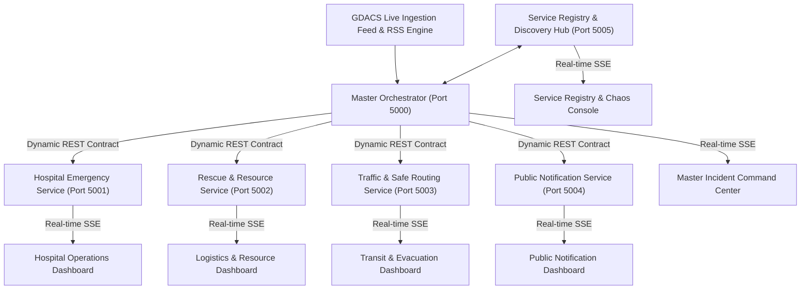

# ResilientResponse: Service-Oriented Emergency Incident Coordination Platform

> **Final Year Project (B.Tech Information Technology)**  
> **Global Disaster Alert & Coordination System (GDACS) Integration**  
> *A Service-Oriented Architecture (SOA) demonstrating Dynamic Service Composition, Discovery, Loose Coupling, and Fault-Tolerant Resilience.*

---

## Executive Summary & Motivation (Slides 01 - 04)

- **The Industry Gap**: Modern disaster warning platforms (e.g. NDMA, GDACS) broadcast alerts reliably, but **coordination after the alert remains manual, slow, and fragmented**.
- **The Core Solution**: *ResilientResponse* bridges the gap between *"what is happening"* and *"what should we do next"*.
- **The Data Upgrade**: Powered by **GDACS** (UN/EU Global Disaster Alert & Coordination System), providing live multi-hazard feeds (Earthquakes, Floods, Cyclones, Volcanoes) adhering to Common Alerting Protocol (CAP v1.2) standards.
- **Service-Oriented Design**: Decomposes emergency response into autonomous, loosely-coupled microservices running on dedicated ports with their own independent state machines, contracts, and operational dashboards.

---

## System Architecture & Port Mapping (Slide 05)

Every service in the platform runs as an independent HTTP server with its own dedicated port:



### Dedicated Service Dashboards & Endpoints

| Port | Service Identity | SOA Role | Key Dashboard Capabilities | Direct URL |
| :---: | :--- | :--- | :--- | :--- |
| **`5000`** | **Master Orchestrator & Command Service** | Orchestration & Dynamic Composition | Esri Dark Cartographic Disaster Map, Live GDACS Feed Ingestion, Dynamic Workflow Progress Stepper, Scenario Injections, Manual Hazard Injector. | [http://localhost:5000](http://localhost:5000) |
| **`5001`** | **Hospital Emergency Service** | Domain Microservice | Regional trauma bed surge capacity, ICU availability, ambulance fleet triage, clinical admission protocols. | [http://localhost:5001](http://localhost:5001) |
| **`5002`** | **Rescue & Resource Management** | Domain Microservice | First responder battalions (NDRF/SDRF), inflatable rescue craft, de-watering pumps, emergency food rations, heavy machinery logistics. | [http://localhost:5002](http://localhost:5002) |
| **`5003`** | **Traffic & Safe Routing Service** | Domain Microservice | Hazard perimeter cordon computation, arterial road closures, ambulance green corridor clearance, evacuation flow rate. | [http://localhost:5003](http://localhost:5003) |
| **`5004`** | **Notification & Citizen Advisory** | Domain Microservice | CAP v1.2 XML feed push, geo-targeted cellular SMS broadcast, 130dB civil defense sirens, multilingual public bulletins (English & Hindi). | [http://localhost:5004](http://localhost:5004) |
| **`5005`** | **Service Registry & Chaos Console** | Governance & Resilience | Dynamic runtime discovery, heartbeat monitor, OpenAPI contracts catalog, and **Chaos Engineering fault-injection toggles**. | [http://localhost:5005](http://localhost:5005) |

---

## Demonstration of the Six SOA Principles (Slide 06)

1. **Loose Coupling**: Services communicate strictly through standard HTTP REST APIs and JSON contracts. No service accesses the internal database or memory of another service.
2. **Service Contracts**: Every microservice exposes an OpenAPI 3.0 specification (`/api/contract`) defining standardized request and response payload schemas.
3. **Discoverability**: The Orchestrator resolves service endpoints dynamically by querying the **Service Registry** on port `5005` rather than hardcoding IP addresses.
4. **Autonomy**: Each service owns its domain logic and operational state (e.g. Hospital manages inpatient trauma beds; Resource manages boats and equipment).
5. **Composability**: Response workflows adapt dynamically to the disaster classification:
   - **Earthquakes (`EQ`)**: Prioritizes casualty triage:  
     `Hospital Service` ➔ `Traffic Service` ➔ `Resource Service` ➔ `Notification Service`
   - **Floods & Cyclones (`FL` / `TC`)**: Prioritizes evacuation and inundation relief:  
     `Resource Service` ➔ `Traffic Service` ➔ `Notification Service` ➔ `Hospital Service`
   - **Chemical Hazards (`HZ`)**: Prioritizes respiratory triage & downwind advisories:  
     `Hospital Service` ➔ `Notification Service` ➔ `Traffic Service` ➔ `Resource Service`
6. **Reusability**: The same atomic domain services compose workflows across diverse hazard classes without rewriting backend code.

---

## Viva Presentation Walkthrough (Step-by-Step for Examiners)

Follow these steps during your project review or viva:

### Step 1: Demonstrate Service Discovery & Independence (Slides 05 & 06)
1. Open the [Service Registry Portal (Port 5005)](http://localhost:5005).
2. Click **"Launch Service Cluster"** in the top navigation.
3. Show the teachers that all 6 services run autonomously on separate ports (`5000` to `5005`), verifying true **Loose Coupling & Autonomy**.
4. Click **"OpenAPI Contract"** on any dashboard to display the machine-readable OpenAPI schema.

### Step 2: Show Live GDACS Ingestion & Dynamic Workflow Composition (Slides 07 & 08)
1. Navigate to the [Master Command Center (Port 5000)](http://localhost:5000).
2. Click **"Sync Live GDACS"** to pull real-time events from the live UN/GDACS feed into the Esri Cartographic map.
3. Click the **"M7.7 Kutch Earthquake"** scenario button.
4. **Point to the Workflow Stepper**: Observe that the Orchestrator dynamically executes `Hospital ➔ Traffic ➔ Resource ➔ Notification`.
5. Switch to the [Hospital Dashboard (Port 5001)](http://localhost:5001) and [Traffic Dashboard (Port 5003)](http://localhost:5003): show that beds have been allocated, ambulances deployed, and green corridors established in real-time.

### Step 3: Demonstrate Dynamic Composition Adaptability (Slide 07)
1. Now click the **"Brahmaputra Basin Flood"** scenario button on Port 5000.
2. Show that the workflow automatically changed sequence to: `Resource (Boats/Pumps) ➔ Traffic ➔ Hospital ➔ Notification`.

### Step 4: The Core SOA Novelty — Chaos Fault-Injection & Graceful Degradation (Slide 10)
1. Open the [Service Registry (Port 5005)](http://localhost:5005).
2. Under **"Chaos Fault-Injection & Resilience Test Bench"**, click **"Simulate Failure"** on **Traffic Service**.
3. Point out that Port 5003 is now marked `Simulated Down` (Red).
4. Return to [Master Orchestrator (Port 5000)](http://localhost:5000) and trigger any disaster scenario.
5. **Show the Result to Teachers**:
   - The Orchestrator detects that Traffic Service is down.
   - Instead of crashing or stalling the entire emergency response chain (the fatal flaw in legacy architectures shown in Slide 02), the system engages **Graceful Degradation**!
   - It completes the remaining steps (Hospital, Resource, Notification) and tags the incident as `Graceful Degradation (1 Fallback)`.
6. Return to Port 5005 and click **"Restore Service"** to restore nominal status.

---

## How to Run Locally

### Prerequisites
- Node.js (v18+ or v24+)

### Startup Command
In PowerShell:
```powershell
npm.cmd start
```
*(Or `node start-all.js`)*

Open your browser at **[http://localhost:5000](http://localhost:5000)**.
